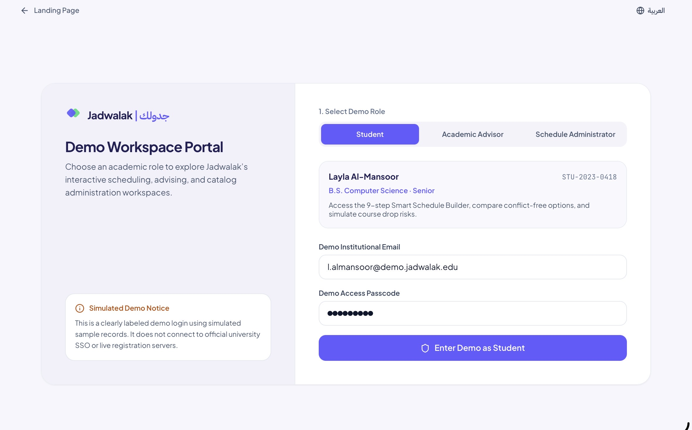
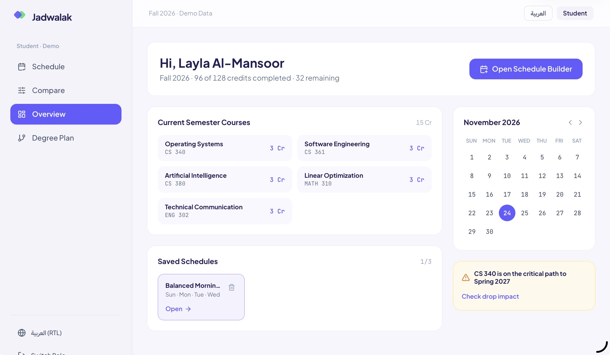
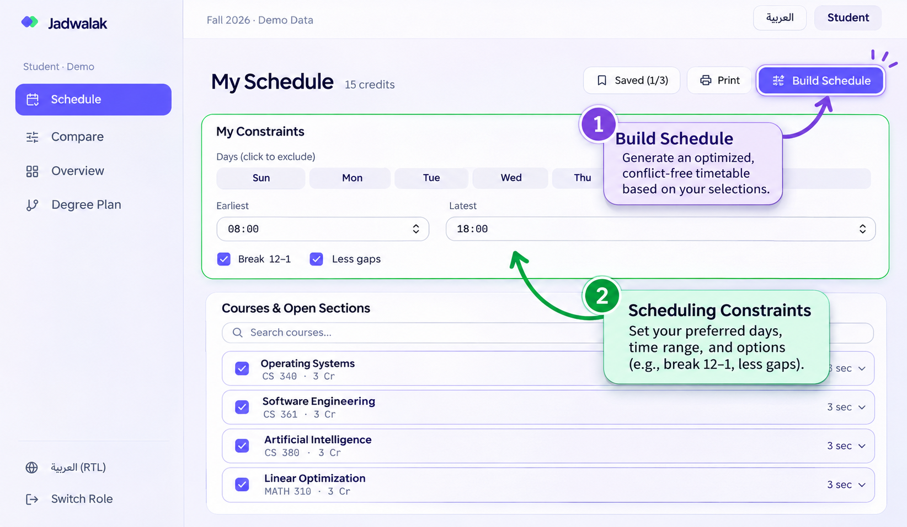
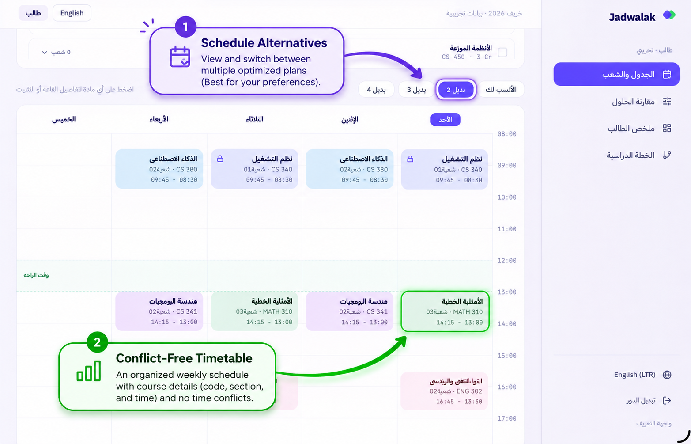
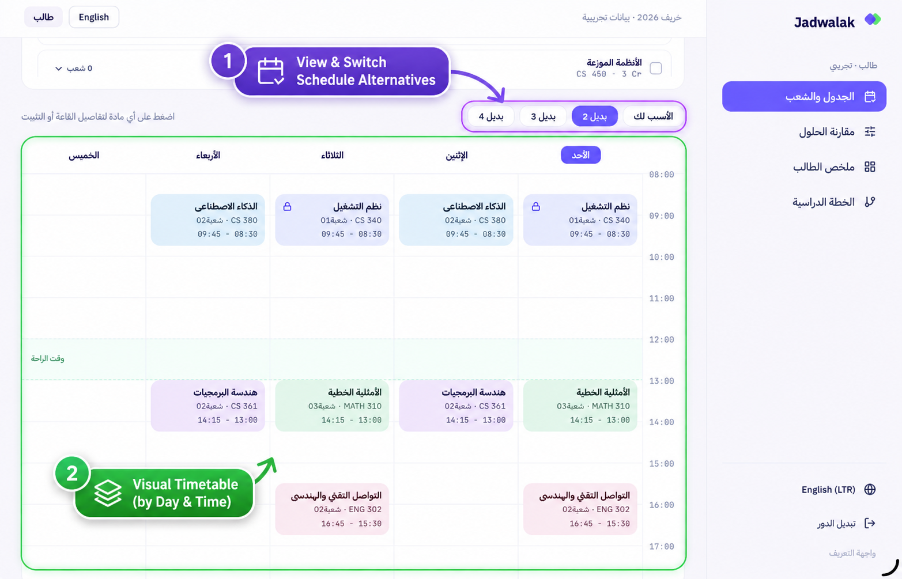
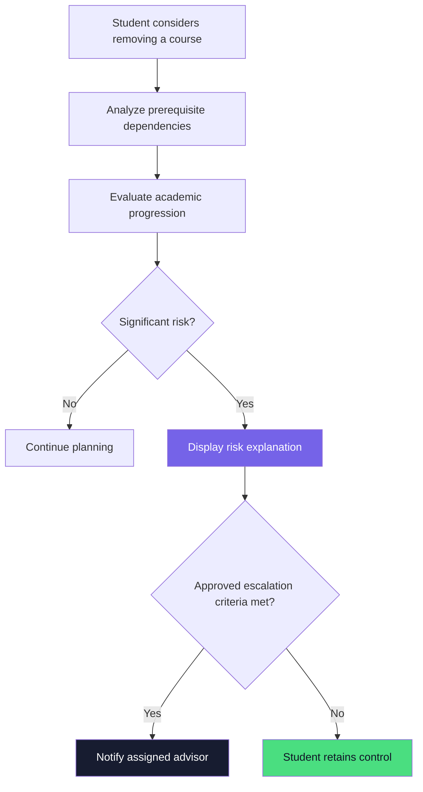
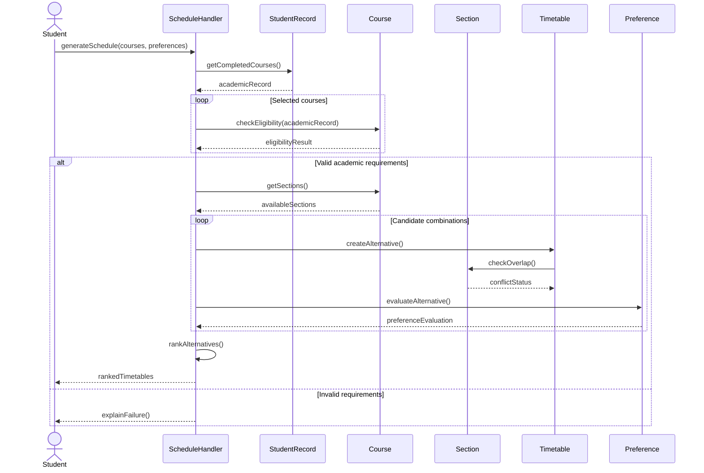
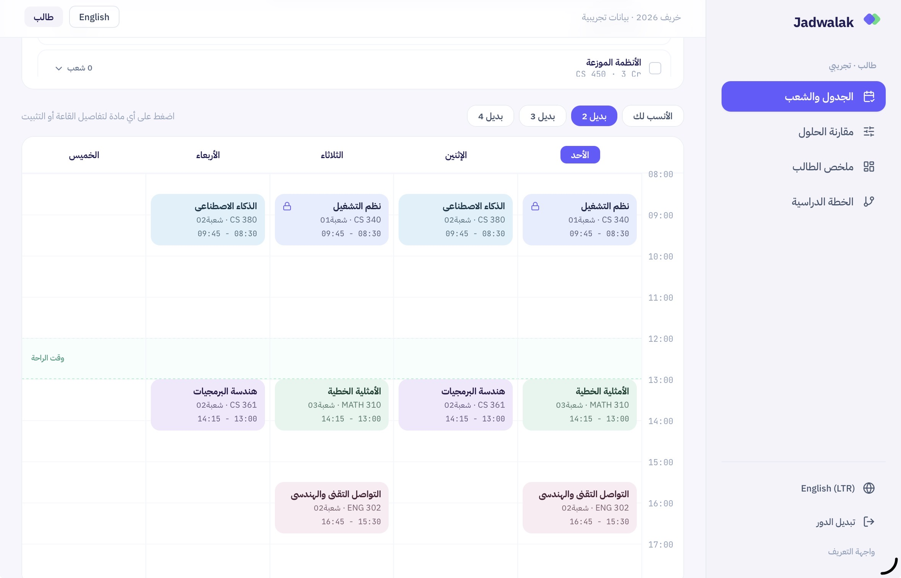
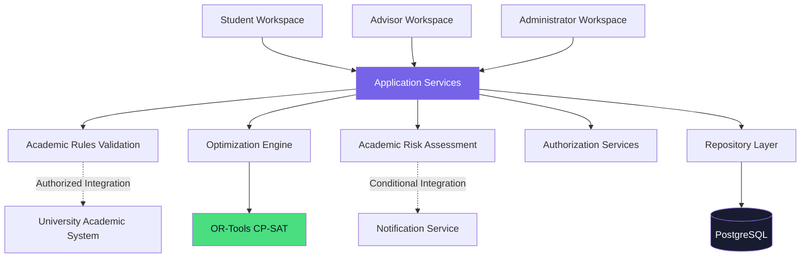

# Jadwalak | جدولك

### Beyond the Timetable

**Academic Planning, Timetable Optimization & Decision Support System**

**King Saud University · College of Computer and Information Sciences · 2026**

---

## 01 — Project Overview

Jadwalak is an academic planning and timetable optimization system designed to help university students make informed academic decisions while staying on track toward graduation.

Unlike conventional timetable planners, Jadwalak approaches academic scheduling as a constraint-based decision-making problem involving academic eligibility, course dependencies, scheduling restrictions, personal preferences, and graduation requirements.

The project combines:

- Requirements Engineering
- Systems Analysis and Design
- Mathematical Optimization
- Academic Decision Support
- Object-Oriented Modeling
- Security Engineering
- Human-Centered Interface Design
- AI-Assisted Engineering

Developed as an academic team project within the Systems Analysis & Design II course at King Saud University.

---

## 02 — Problem Identification

University students frequently encounter difficulties when constructing their academic schedules.

| Problem | Academic Impact |
|---|---|
| Overlapping course sections | Invalid timetable combinations |
| Manual schedule construction | Increased planning time |
| Long gaps between classes | Inefficient campus attendance |
| Prerequisite restrictions | Academic ineligibility |
| Poor course selection | Potential graduation delays |
| Limited academic visibility | Uninformed registration decisions |

A timetable may satisfy a student's personal preferences while negatively affecting their academic progression.

Jadwalak addresses this problem by connecting timetable planning with academic decision support.

---

## 03 — Engineering Methodology

The system was developed through a structured analysis and design process.

Each stage contributed to defining the system's behavior, responsibilities, constraints, and proposed architecture.

---

## 04 — Stakeholder Analysis

Three primary stakeholder groups were identified according to their responsibilities within the academic planning environment.

<em>Figure 1 — Role-based workspace selection using simulated academic accounts.</em>

| Stakeholder | Responsibilities |
|---|---|
| Student | Construct, compare, personalize, and save academic schedules |
| Academic Advisor | Review academic progression and significant graduation risks |
| Schedule Administrator | Manage and validate published timetable information |

### Role-Based System Design

The proposed system separates functionality according to user responsibilities.

Students interact with scheduling and academic planning services.

Academic advisors access relevant academic information for assigned students, subject to authorization.

Schedule administrators manage published course and section information.

The prototype demonstrates role-specific entry points using simulated accounts. It does not connect to official university authentication or registration services.

---

## 05 — Requirements Elicitation

### Elicitation Method

AI-simulated stakeholder interviews were used to explore the needs of students, academic advisors, and schedule administrators.

The interviews followed a progressive questioning methodology:

1. Identify stakeholder responsibilities.
2. Investigate existing academic planning difficulties.
3. Explore current decision-making processes.
4. Identify expected system capabilities.
5. Examine exceptional scenarios.
6. Clarify ambiguous responses.
7. Translate stakeholder needs into functional requirements.
8. Define system boundaries.

### Scenario-Based Analysis

An academic advisor scenario investigated the consequences of removing a required course from a student's proposed timetable.

The analysis identified several relevant factors:

- Prerequisite dependencies.
- Course offering frequency.
- Remaining graduation requirements.
- Potential academic progression delays.
- Appropriate advisor intervention.

This scenario contributed to the proposed academic risk assessment and notification requirements.

All documented stakeholder interviews were AI simulations rather than interviews with actual university employees or students.

---

## 06 — Requirements Analysis & Revision

### Revised Functional Requirements

| ID | Requirement Statement |
|---|---|
| FR-01 | The system shall display published course and section information from an approved source. |
| FR-02 | The system shall show section meeting times, instructors and other available published details. |
| FR-03 | The system shall allow students to select courses for a proposed timetable. |
| FR-04 | The system shall use available academic progress data to inform planning, with source and freshness visible. |
| FR-05 | The system shall check known prerequisite and co-requisite rules. |
| FR-06 | The system shall validate proposed credit-hour limits using approved rules. |
| FR-07 | The system shall generate feasible timetable alternatives from selected courses. |
| FR-08 | The system shall exclude overlapping class sections from feasible alternatives. |
| FR-09 | The system shall collect mandatory constraints separately from optional preferences. |
| FR-10 | The system shall rank feasible alternatives against ordered student preferences. |
| FR-11 | The system shall present multiple feasible alternatives where available. |
| FR-12 | The system shall enable side-by-side comparison of alternatives. |
| FR-13 | The system shall explain important trade-offs among proposed schedules. |
| FR-14 | The system shall preserve student-locked sections during regeneration. |
| FR-15 | The system shall allow preference changes and regeneration. |
| FR-16 | The system shall allow a student to retain a preferred proposed timetable. |
| FR-17 | The system shall regenerate alternatives after changes to selected courses or sections. |
| FR-18 | The system shall explain conflicts or unmet constraints if no valid timetable can be generated. |
| FR-19 | The system shall allow authorized advisors to locate assigned student planning records by approved identifier. |
| FR-20 | The system shall show authorized advisors relevant progress and proposed planning information. |
| FR-21 | The system shall detect and explain identifiable academic progression risks when a student removes a required course from a proposed timetable, using available study-plan and prerequisite evidence; it shall label an assessment as uncertain when the available evidence is insufficient. |
| FR-22 | The system shall notify the assigned academic advisor when a detected academic risk meets approved intervention criteria and shall consolidate duplicate notifications. |
| FR-23 | The system shall allow authorized staff to import and validate published section data; reject incomplete or invalid records. |
| FR-24 | The system shall apply authorized timetable updates and show source version or last-updated time. |
| FR-25 | The system shall allow each student to save up to three active proposed timetable alternatives and shall require explicit replacement of an existing version before saving a fourth. |
| FR-26 | The system shall clearly state that published sections do not guarantee available seats and that official course enrollment occurs outside Jadwalak. |
| FR-27 | The system shall allow students to export or print their selected proposed timetable, including course names, course codes, section numbers, meeting days, and class times, for reference during official university registration. |
| FR-28 | The system shall require students, academic advisors, and schedule administrators to authenticate using an authorized university account before accessing role-restricted functions, subject to institutional authorization and integration availability. |

### Non-Functional Requirements

| ID | Requirement Statement |
|---|---|
| NFR-01 | The system shall enforce role-based access control and least-privilege permissions for students, assigned academic advisors, and schedule administrators. |
| NFR-02 | The system shall prevent unauthorized modification of official enrollment data and university academic records. |
| NFR-03 | The system shall present constraints, schedule alternatives, trade-offs, and risk explanations in understandable and accessible language. |
| NFR-04 | The system shall validate imported timetable data and retain traceable information about authorized updates. |
| NFR-05 | The system should complete at least 95% of standard timetable-generation requests within five seconds under a defined benchmark workload; this is a proposed target, not a verified measurement. |
| NFR-06 | The system shall protect student personal and academic information in transit and at rest using institution-approved security controls. |
| NFR-07 | The system shall visually distinguish planning recommendations from official enrollment status. |
| NFR-08 | The system shall log privileged access and timetable imports to the extent permitted by institutional policy. |
| NFR-09 | The system shall display relevant data freshness information and disclose uncertainty in academic-risk estimates. |
| NFR-10 | The system shall handle failed schedule generation and invalid imports without corrupting previously saved valid data. |

### Business Rules

| ID | Rule |
|---|---|
| BR-01 | A valid proposed timetable must not contain overlapping scheduled class meetings. |
| BR-02 | Course eligibility must follow approved prerequisite and co-requisite rules. |
| BR-03 | Planned credit loads must comply with applicable approved limits unless an authorized exception applies. |
| BR-04 | Published course and section data must originate from an authorized source. |
| BR-05 | Only authorized roles may manage published section data or approve institutional exceptions. |
| BR-06 | Saving a timetable in Jadwalak does not enroll the student in any course. |
| BR-07 | Jadwalak must not create official sections, reserve seats, or guarantee seat availability. |
| BR-08 | The student retains control of changes to the proposed timetable; Jadwalak may warn or notify an advisor but must not silently remove planned courses or override the student’s choices. Official university rules still apply. |
| BR-09 | Immediate advisor notifications must be limited to risks meeting approved escalation criteria; repeated alerts should be consolidated. |
| BR-10 | A student may maintain at most three active saved alternatives during the registration period; post-registration retention requires an approved policy. |

The initial requirements were critically reviewed to identify ambiguity, missing functionality, conflicting expectations, and insufficiently defined system behavior.

AI was assigned the role of a senior systems analyst to critique the requirements.

### Accept / Modify / Reject Framework

| Decision | Purpose |
|---|---|
| Accept | Incorporate suitable recommendations |
| Modify | Adapt recommendations to project constraints |
| Reject | Exclude unsuitable or out-of-scope recommendations |

### Engineering Decisions

| Identified Issue | Proposed Resolution |
|---|---|
| Published sections versus live seat availability | Explicitly distinguish timetable information from guaranteed registration availability |
| Academic data access | Authorized read-only integration |
| Undefined preference priorities | Separate mandatory constraints from ordered preferences |
| Conflicting locked sections | Preserve selections and explain infeasibility |
| Excessive advisor notifications | Apply controlled escalation criteria |
| Invalid timetable imports | Validate data before acceptance |
| Unmeasurable performance requirements | Establish measurable performance targets |
| Saved timetable management | Support three active alternatives with explicit replacement |

### Requirements Baseline

| Deliverable | Quantity |
|---|---:|
| Stakeholder Groups | 3 |
| Initial Functional Requirements | 24 |
| Revised Functional Requirements | 28 |
| Non-functional Requirements | 10 |
| Business Rules | 10 |

---

## 07 — Student Academic Dashboard

<em>Figure 2 — Centralized academic overview and decision-support dashboard.</em>

The student dashboard provides a consolidated representation of academic information.

### Academic Progress Tracking

The interface displays:

- Completed credit hours.
- Total degree requirements.
- Remaining credit hours.
- Current semester courses.

For the simulated student shown in the prototype:

- Total required credits: 128
- Completed credits: 96
- Remaining credits: 32
- Current planned credits: 15

Academic completion can be represented as:

$$
Progress = \frac{CompletedCredits}{RequiredCredits}\times100
$$

For the displayed example:

$$
Progress = \frac{96}{128}\times100 = 75\%
$$

### Saved Schedule Management

The dashboard provides access to previously saved timetable alternatives.

The proposed business rules allow students to maintain up to three active saved schedules.

### Academic Risk Awareness

The dashboard also displays warnings related to courses that may affect future academic progression.

These warnings provide access to further course-drop impact analysis.

---

## 08 — Smart Schedule Builder

The scheduling workflow transforms student preferences and course selections into a structured optimization problem.

<table>
<tr>
<td width="50%" align="center">

 
<b>01 — Input & Constraints</b>
</td>
<td width="50%" align="center">

 
<b>02 — Timetable Alternatives</b>
</td>
</tr>
</table>

<em>Figure 3 — Annotated interface illustrations of the scheduling input and output workflow.</em>

### Input Parameters

The interface allows students to specify:

- Selected academic courses.
- Preferred attendance days.
- Earliest acceptable class time.
- Latest acceptable class time.
- Preferred break periods.
- Gap minimization preferences.
- Selected or locked sections.

### Processing Mechanism

The proposed scheduling engine performs:

1. Academic eligibility validation.
2. Published section retrieval.
3. Mandatory constraint evaluation.
4. Time conflict detection.
5. Feasible combination generation.
6. Preference-based ranking.
7. Alternative timetable generation.

### Output

The interface demonstrates multiple timetable alternatives presented through an interactive weekly calendar.

Each scheduled course contains its course identifier, section identifier, and meeting time.

---

## 09 — Mathematical Optimization Model

### Problem Formulation

Academic timetable generation is modeled as a constrained combinatorial optimization problem.

Each selected course may have several published section options.

The objective is to identify feasible section combinations while satisfying academic requirements and optimizing student preferences.

### Decision Variables

Let:

$$
x_{c,s}\in\{0,1\}
$$

Where:

- c represents a selected course.
- s represents a section option.
- x = 1 indicates that the section is selected.
- x = 0 indicates that the section is not selected.

### Hard Constraints

Hard constraints determine whether a timetable is feasible.

#### Section Selection

Exactly one compatible section option must be selected for each requested course.

$$
\sum_{s\in S_c}x_{c,s}=1
$$

Associated lecture and laboratory requirements must also be respected.

#### Time Conflict Prevention

If two section options contain overlapping meetings, both cannot be selected simultaneously.

$$
x_i+x_j\leq1
$$

Two meetings overlap when they occur on the same day and:

$$
start_i < end_j
$$

and:

$$
start_j < end_i
$$

#### Academic Eligibility

Course selection must respect applicable prerequisite and co-requisite rules.

#### Credit-Hour Validation

The proposed academic load must satisfy institutional credit-hour restrictions.

$$
C_{min}\leq\sum_{c\in C}credits_c\leq C_{max}
$$

#### Locked Sections

A locked section must remain selected during timetable regeneration.

$$
x_{c,s}=1
$$

If locked sections make the problem infeasible, the proposed system explains the conflict rather than silently removing them.

### Soft Constraints

Soft constraints represent student preferences.

Examples include:

- Minimizing campus attendance days.
- Minimizing gaps between classes.
- Avoiding undesirable meeting times.
- Preserving preferred break periods.
- Favoring preferred sections.

### Preference-Based Optimization

An illustrative mathematical approach is lexicographic optimization:

$$
\min_{\mathrm{lex}}(f_1(x),f_2(x),...,f_m(x))
$$

Each objective represents a preference ordered by the student.

Higher-priority objectives are optimized before lower-priority objectives.

The mathematical formulation is an explanatory extension of the proposed system design, not a claim of verified solver implementation.

---

## 10 — Optimization Solver Evaluation

Two optimization technologies were evaluated for the proposed system.

| Criterion | OR-Tools CP-SAT | Timefold Solver |
|---|---|---|
| Constraint Modeling | Explicit mathematical constraints | Constraint-based scoring |
| Hard Constraints | Direct feasibility enforcement | Hard-score evaluation |
| Preferences | Sequential or weighted objectives | Score-based optimization |
| Locked Sections | Fixed decision variables | Pinning or constraints |
| Alternative Generation | Repeated solving with exclusions | Repeated solving or diversification |
| Java Integration | Java API | Java-based framework |

### Proposed Solver: Google OR-Tools CP-SAT

CP-SAT was selected for the proposed implementation because of its suitability for binary decision variables, explicit constraints, feasibility checking, and combinatorial optimization.

### Alternative Generation

After obtaining one feasible solution, the exact selected combination can be excluded from subsequent solver runs.

For a previously selected combination containing k section variables:

$$
\sum_{i\in S^*}x_i\leq k-1
$$

This enables the proposed solver to search for distinct alternatives.

### Solver Status Handling

The system should distinguish between:

- Optimal solution.
- Feasible solution.
- Proven infeasibility.
- Inconclusive search.

A solver timeout must not be interpreted as proof of infeasibility.

---

## 11 — Schedule Visualization & Interaction

<em>Figure 4 — Annotated visualization of timetable alternatives and weekly calendar interaction.</em>

### Alternative Navigation

The prototype displays a best-match option and additional timetable alternatives.

Students can navigate between alternatives to inspect different academic schedules.

### Weekly Calendar

The calendar organizes course meetings according to their corresponding day and time.

Color-coded course blocks improve visual differentiation between academic subjects.

### Section Locking

The interface displays locked sections, illustrating the intended ability to preserve selected course sections during schedule regeneration.

### Explainable Scheduling

The proposed design aims to communicate why alternatives differ, rather than presenting a single schedule without context.

---

## 12 — Academic Decision Support

Jadwalak extends beyond timetable generation by considering how academic decisions may influence graduation.

<em>Figure 5 — Academic risk awareness integrated into the student dashboard.</em>

### Prerequisite Dependency Analysis

Course dependencies can be represented as a directed graph:

$$
G=(V,E)
$$

Where:

- V represents academic courses.
- E represents prerequisite relationships.

A directed edge from course A to course B indicates that A must be completed before B, according to the applicable prerequisite rule.

Removing a course may affect directly and indirectly dependent courses.

### Proposed Risk Assessment

The system evaluates:

- Prerequisite relationships.
- Dependent courses.
- Course offering frequency.
- Remaining graduation requirements.
- Potential academic progression delays.

### Evidence and Uncertainty

The proposed design distinguishes between:

**Confirmed academic rules**

Institutional requirements supported by authorized academic data.

**Projected academic consequences**

Estimated future outcomes that depend on assumptions about course availability and institutional decisions.

### Intervention Workflow

Advisor notifications require institutional approval and authorized integration.

The graph-based formulation is an illustrative technical explanation of the proposed academic dependency analysis.

---

## 13 — Object-Oriented Systems Design

### Selected Use Case

**Generate Optimized Schedule**

This use case represents the central interaction between academic validation, course selection, timetable construction, and preference evaluation.

### Domain Responsibilities

| Object | Responsibility |
|---|---|
| ScheduleHandler | Coordinate schedule generation |
| StudentRecord | Provide academic progress information |
| Course | Represent course eligibility and associated sections |
| Section | Represent scheduled meetings |
| Timetable | Represent an individual timetable alternative |
| Preference | Represent student scheduling preferences |

### Simplified Sequence Diagram

### Design Review

The initial interaction model was reviewed to improve:

- Object responsibility allocation.
- Separation of coordination and domain behavior.
- Academic eligibility conditions.
- Alternative and failure paths.
- Preference evaluation responsibilities.

The diagram above is a simplified explanatory representation of the proposed design.

---

## 14 — Bilingual User Experience

<table>
<tr>
<td width="50%" align="center">

 
<b>English — LTR</b>
</td>
<td width="50%" align="center">

 
<b>Arabic — RTL</b>
</td>
</tr>
</table>

<em>Figure 6 — English and Arabic interface examples.</em>

The prototype demonstrates a bilingual experience supporting English and Arabic.

### Localization Mechanisms

- Left-to-right English navigation.
- Right-to-left Arabic navigation.
- Localized interface labels.
- Adapted calendar orientation.
- Consistent visual identity.
- Language switching within the workspace.

The bilingual design addresses the needs of Arabic-speaking university students while maintaining accessibility for English-speaking users.

---

## 15 — Development Methodology

### Selected Approach

**Lightweight Agile / Scrum**

Agile was selected as the proposed development methodology because the system involves evolving requirements, unresolved institutional integration dependencies, and iterative interface refinement.

### Proposed Development Structure

| Phase | Objective |
|---|---|
| Sprint 0 | Establish architecture and domain-model baseline |
| Development Sprints | Incremental implementation |
| Sprint Reviews | Evaluate completed functionality |
| Backlog Refinement | Prioritize requirements and resolve uncertainties |
| Validation | Evaluate functional and non-functional requirements |

### Supporting Practices

- MoSCoW prioritization.
- T-shirt size estimation.
- Iterative design reviews.
- Requirements traceability.
- Team coordination.
- Incremental validation.

---

## 16 — Security Engineering

The proposed security architecture addresses authentication, authorization, confidentiality, integrity, privacy, and availability.

| Security Domain | Proposed Control |
|---|---|
| Authentication | Authorized university SSO |
| Privileged Accounts | University-provided MFA |
| Session Management | Secure cookies and inactivity timeout |
| Authorization | Role-based access control |
| Record-Level Access | Ownership and advisor assignment checks |
| Confidentiality | TLS and encryption at rest |
| Data Integrity | Server-side validation |
| Import Security | Schema validation and controlled rollback |
| Database Security | Parameterized queries and least privilege |
| Privacy | Data minimization and approved retention policies |
| Accountability | Audit logging |
| Availability | Rate limiting and bounded solver execution |

### Access Control Model

| Capability | Student | Advisor | Administrator |
|---|---|---|---|
| Manage own proposed timetable | Yes | No | No |
| Review assigned student plans | No | Yes | No |
| Receive qualifying risk alerts | No | Yes | No |
| Import published timetable data | No | No | Yes |
| Modify official academic records | No | No | No |

These controls represent proposed production requirements rather than independently verified security mechanisms.

---

## 17 — Software Reuse & Architecture

Reusable components were evaluated according to functional suitability, compatibility, maintainability, security, licensing, and integration complexity.

### Proposed Technology Stack

| Component | Responsibility |
|---|---|
| Google OR-Tools CP-SAT | Constraint-based timetable optimization |
| Spring Boot | Application services |
| Spring Security | Authentication and authorization |
| PostgreSQL | Structured data persistence |
| FullCalendar | Timetable visualization |
| Apache Commons CSV | Published timetable data parsing |
| jsPDF | Timetable export |
| University SSO | Conditional institutional authentication |
| Email Service | Conditional advisor notifications |

### Design Patterns

**Strategy Pattern**

Separates preference-ranking policies from the core scheduling workflow.

**Observer Pattern**

Separates academic risk events from notification handling.

**Repository Pattern**

Separates persistence operations from business logic.

### Proposed Logical Architecture

The architecture represents a proposed implementation blueprint, not a verified inventory of the deployed prototype's technology stack.

---

## 18 — Requirements Traceability & Validation

Requirements were connected to their corresponding design mechanisms.

| Requirement Area | Design Mechanism |
|---|---|
| Academic Eligibility | Prerequisite validation |
| Credit Restrictions | Academic load validation |
| Schedule Generation | Constraint-based optimization |
| Conflict Prevention | Meeting overlap detection |
| Student Preferences | Ordered preference evaluation |
| Section Locking | Fixed section selection |
| Academic Risk | Dependency analysis |
| Advisor Intervention | Conditional escalation |
| Data Imports | Authorized schema validation |
| Authentication | Proposed institutional integration |

### Proposed Validation Scenarios

| Test Scenario | Expected Behavior |
|---|---|
| Overlapping sections | Exclude invalid combinations |
| Missing prerequisite | Explain academic ineligibility |
| Excessive credit load | Reject invalid academic load |
| Conflicting locked sections | Explain infeasibility |
| Multiple feasible schedules | Present distinct alternatives |
| Solver timeout | Report inconclusive search |
| Required course removal | Assess academic progression risk |
| Unauthorized access | Deny access |
| Invalid timetable import | Reject invalid records |
| Fourth saved schedule | Request explicit replacement |

### Performance Targets

The proposed performance requirements include:

- 95% of standard timetable generation requests within five seconds.
- Support for up to seven selected courses in the standard generation scenario.
- A proposed registration-period workload of 1,000 concurrent users.

These are design targets and not measured benchmark results.

---

## 19 — AI-Assisted Systems Engineering

ChatGPT and Claude were used as simulated stakeholders and specialized engineering consultants.

| Engineering Stage | AI Role |
|---|---|
| Requirements Elicitation | Simulated stakeholder |
| Requirements Revision | Senior systems analyst |
| Development Methodology | Methodology consultant |
| Use Case Realization | Object-oriented design consultant |
| Security Engineering | Security consultant |
| Software Reuse | Architecture and reuse consultant |

AI-generated recommendations were critically evaluated using the Accept, Modify, or Reject framework.

Final engineering decisions remained the responsibility of the project team.

---

## 20 — My Contribution

### Wala Chadi — Requirements Engineering

My primary responsibility was Requirements Elicitation and Requirements Revision.

My contributions included:

- Stakeholder identification and analysis.
- Progressive AI-simulated stakeholder interviews.
- Academic scheduling scenario exploration.
- Initial functional requirements extraction.
- Identification of ambiguous and missing requirements.
- Functional and non-functional requirements refinement.
- Business rule analysis.
- Academic progression and graduation-risk analysis.
- Critical evaluation of AI-generated recommendations.
- Contribution to the final requirements baseline.

This project strengthened my experience in systems analysis, requirements engineering, analytical problem-solving, constraint-based thinking, and academic decision-support design.

---

## 21 — Project Scope & Limitations

Jadwalak is an academic systems analysis and design project supported by an interactive prototype.

The prototype uses simulated academic data.

It does not:

- Perform official university registration.
- Reserve course seats.
- Guarantee real-time seat availability.
- Modify official academic records.
- Provide verified production-level institutional integration.

The mathematical models, architecture diagrams, security controls, and solver selection describe the proposed engineering design.

Annotated interface illustrations are used to explain intended functionality and may differ slightly from the original screenshots.

---

## 22 — Interactive Prototype

### 🌐 Explore Jadwalak — Live Website

**[🚀 Click here to launch Jadwalak](https://jadwalak-ai-academic-planning-platform-614442925222.europe-west2.run.app)**

Experience the interactive prototype directly in your browser.
No installation required.

---

### JADWALAK | جدولك

**Beyond the Timetable.**

Systems Engineering · Mathematical Optimization · Academic Decision Support

