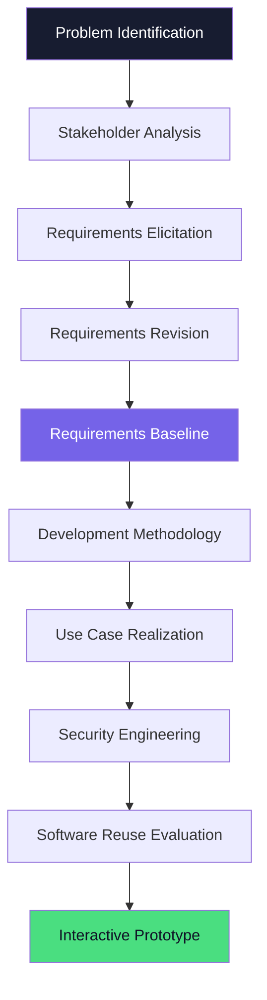
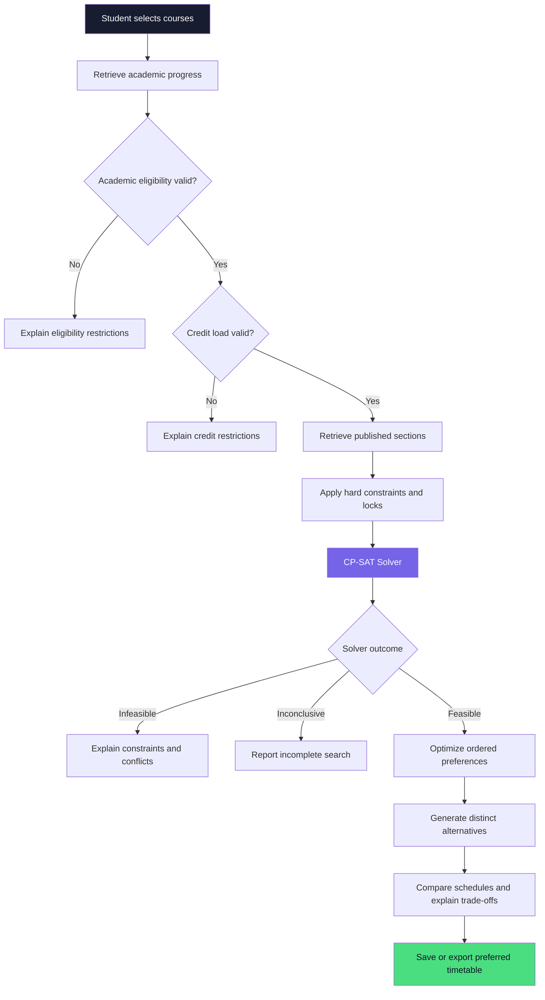
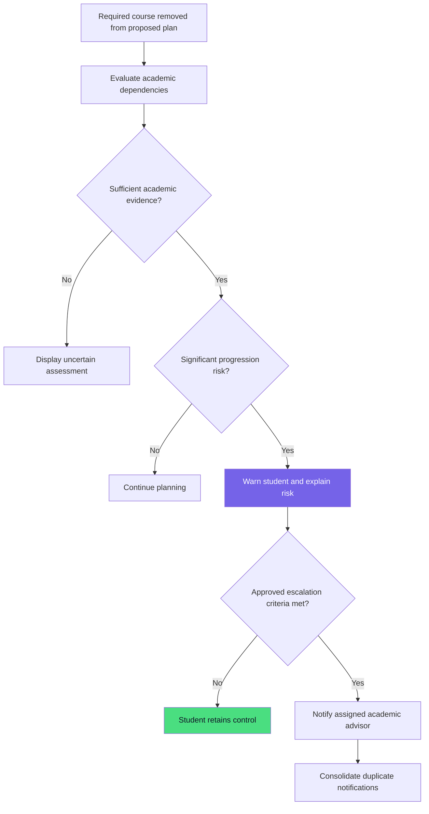
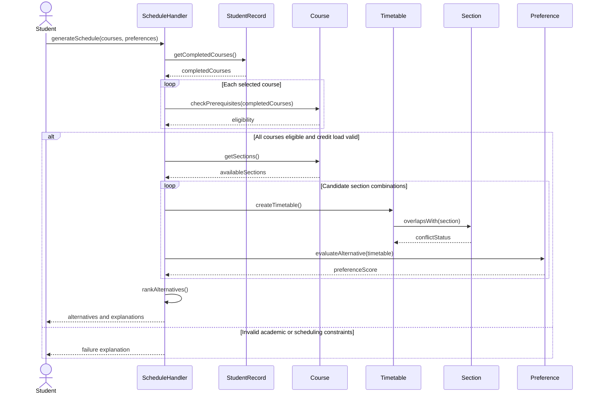
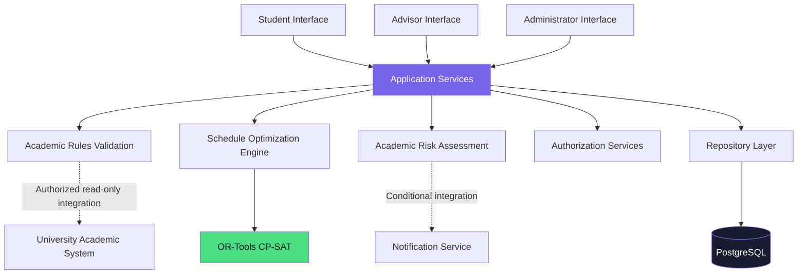

# Jadwalak | جدولك

### Beyond the Timetable

**Academic Planning, Timetable Optimization & Decision Support System**

---

## 01 — Project Overview

Jadwalak is an academic planning and timetable optimization system designed to support university students in making informed academic decisions.

Rather than treating scheduling as a simple calendar arrangement problem, Jadwalak approaches it as a constraint-based decision-making problem that considers academic eligibility, individual preferences, course dependencies, and graduation requirements.

The project was developed within the Systems Analysis & Design II course at King Saud University, combining requirements engineering, object-oriented design, optimization modeling, security engineering, and AI-assisted analysis.

### The Problem

University students frequently face:

- Complex combinations of available course sections.
- Overlapping lectures and laboratory sessions.
- Inefficient manual timetable comparisons.
- Long waiting periods between classes.
- Academic prerequisite and credit-hour restrictions.
- Limited awareness of how scheduling decisions may affect graduation.

A timetable may appear convenient while creating significant academic progression risks.

### The Proposed Solution

Jadwalak is designed to generate feasible timetable alternatives, rank them according to individual preferences, explain scheduling trade-offs, and identify potential academic progression risks before students complete official registration.

---

## 02 — Project at a Glance

| Engineering Deliverable | Quantity |
|---|---:|
| Stakeholder Groups | 3 |
| Initial Functional Requirements | 24 |
| Revised Functional Requirements | 28 |
| Non-functional Requirements | 10 |
| Business Rules | 10 |
| Security Risks Evaluated | 21 |
| Software Reuse Candidates Evaluated | 15 |
| Optimization Solvers Compared | 2 |
| Team Members | 5 |

---

## 03 — Systems Analysis Framework

The project followed a structured analysis and design process in which each engineering stage informed the next.

AI was used throughout the process as an analytical assistant, while final engineering decisions remained under the responsibility of the project team.

---

## 04 — Stakeholder Analysis & Requirements Elicitation

### Methodology

Requirements were initially collected through AI-simulated stakeholder interviews.

Three stakeholder personas were established to represent different perspectives within the academic scheduling environment.

| Stakeholder | Primary Concerns |
|---|---|
| University Student | Schedule conflicts, preferred times, campus days, academic progress |
| Academic Advisor | Prerequisites, graduation risks, academic intervention |
| Schedule Administrator | Data accuracy, authorized imports, timetable updates |

The interviews were structured around progressive questioning, clarification, scenario exploration, and follow-up questions.

### Analysis Mechanism

The elicitation process followed these steps:

1. Identify the stakeholder's responsibilities and objectives.
2. Explore existing scheduling difficulties.
3. Investigate current decision-making processes.
4. Identify expected system capabilities.
5. Examine exceptional and conflicting scenarios.
6. Clarify ambiguous stakeholder responses.
7. Translate identified needs into functional requirements.
8. Establish system boundaries.

### Example: Academic Progression Risk

A simulated academic advisor interview explored the consequences of removing a required course from a proposed timetable.

The analysis identified that a scheduling decision could affect future academic progress when:

- The course is a prerequisite for subsequent courses.
- The course is offered only once per academic year.
- The course belongs to the final academic level.

This led to requirements for academic risk detection, student warnings, and conditional advisor notifications.

### Outcome

The elicitation stage produced 24 initial functional requirements.

All stakeholder interviews were simulations conducted using ChatGPT. They were not interviews with actual university employees or students.

---

## 05 — Requirements Analysis & Revision

The initial requirements were reviewed to identify ambiguity, missing information, conflicting expectations, and insufficiently defined system behavior.

ChatGPT was assigned the role of a senior systems analyst to critique the requirements rather than independently finalize them.

### Critical Evaluation Framework

Each recommendation was evaluated using three possible decisions:

| Decision | Meaning |
|---|---|
| Accept | The recommendation satisfies the system's needs and scope. |
| Modify | The recommendation is useful but requires adaptation. |
| Reject | The recommendation is unnecessary, unsuitable, or outside the project scope. |

### Key Engineering Decisions

| Identified Issue | Final Design Decision |
|---|---|
| Published sections versus live seat availability | Use published timetable data and explicitly disclose that seats are not guaranteed. |
| Academic data source | Use an authorized read-only source with visible data freshness. |
| Undefined preference ranking | Separate mandatory constraints from ordered optional preferences. |
| Locked sections preventing valid schedules | Preserve locks and explain why a valid result cannot be generated. |
| Excessive advisor notifications | Warn students first and notify advisors only under approved intervention criteria. |
| Invalid timetable imports | Validate required fields and reject invalid records. |
| Unmeasurable performance requirements | Define a measurable performance benchmark. |
| Saved timetable management | Allow three active alternatives with explicit replacement. |

The initial review resulted in five accepted and three modified recommendations.

Additional requirements for authentication and timetable export were subsequently incorporated.

### Final Requirements Baseline

- 28 Functional Requirements
- 10 Non-functional Requirements
- 10 Business Rules

This baseline provides the foundation for subsequent system design decisions.

---

## 06 — Constraint-Based Timetable Optimization

### Problem Formulation

The scheduling problem is modeled as a constrained selection problem.

Each course may have several published sections, and each section may contain one or more scheduled meetings.

The system must identify combinations of sections that satisfy mandatory academic and scheduling constraints while maximizing satisfaction of student preferences.

### Decision Variables

For the proposed optimization model, let:

$$
x_{c,s} \in \{0,1\}
$$

Where:

- c represents a selected course.
- s represents an available section.
- x = 1 means the section is selected.
- x = 0 means the section is not selected.

### Hard Constraints

Hard constraints define whether a proposed timetable is feasible.

#### 1. Section Selection

Exactly one compatible section option must be selected for each requested course.

$$
\sum_{s \in S_c} x_{c,s} = 1
$$

Associated lecture and laboratory requirements must also be respected.

#### 2. Conflict Detection

If two section options contain overlapping scheduled meetings, they cannot both be selected.

$$
x_i + x_j \leq 1
$$

Two meetings overlap when they occur on the same day and:

$$
start_i < end_j
$$

and

$$
start_j < end_i
$$

#### 3. Academic Eligibility

Selected courses must satisfy approved prerequisite and co-requisite rules.

Previously completed courses and available academic progress information are considered during eligibility validation.

#### 4. Credit-hour Restrictions

The proposed course load must comply with applicable academic credit-hour limits.

$$
C_{min} \leq \sum_{c \in C} credits_c \leq C_{max}
$$

The applicable limits depend on the student's academic status and approved institutional rules.

#### 5. Locked Sections

When a student locks a section, that selection must remain fixed during regeneration.

$$
x_{c,s} = 1
$$

If locked sections prevent a feasible solution, the system must explain the conflict rather than silently removing the locks.

### Soft Constraints

Soft constraints represent preferences rather than mandatory conditions.

Examples include:

- Minimizing the number of campus days.
- Minimizing gaps between classes.
- Avoiding undesirable class times.
- Favoring preferred sections or meeting times.

Students arrange their preferences in order of importance.

### Preference-based Ranking

The proposed design supports ordered optimization objectives rather than arbitrary fixed preference weights.

A possible implementation is lexicographic optimization:

$$
\min_{\mathrm{lex}} (f_1(x),f_2(x),...,f_m(x))
$$

Where each objective represents a preference ordered by the student.

For example, if minimizing campus days is ranked above minimizing gaps, a timetable with fewer campus days receives priority even when another alternative has shorter gaps.

The exact scoring and tie-breaking implementation requires further development and validation.

---

## 07 — Optimization Solver Selection

Two optimization libraries were evaluated:

| Criterion | OR-Tools CP-SAT | Timefold Solver |
|---|---|---|
| Hard Constraints | Explicit constraint modeling | Hard-score constraints |
| Ordered Preferences | Sequential objectives or bounded weights | Score levels or custom scoring |
| Locked Sections | Fixed selection variables | Pinning or constraints |
| Multiple Alternatives | Repeated solving with exclusions | Repeated solving or diversification |
| Infeasibility | Explicit solver status | Requires verification of hard-score violations |
| Integration | Java API and native runtime | Java domain and constraint model |

### Selected Solver: Google OR-Tools CP-SAT

OR-Tools CP-SAT was selected for the proposed implementation because it supports explicit feasibility constraints, binary decision variables, locked selections, and repeated optimization.

Timefold was retained as a possible fallback but was not selected as an additional dependency.

### Generating Multiple Alternatives

After identifying one feasible timetable, the previous solution can be excluded from subsequent solver runs.

For a timetable containing k selected section variables:

$$
\sum_{i \in S^*} x_i \leq k-1
$$

This prevents the solver from returning the exact same section combination.

Repeated solving can therefore generate distinct alternatives for comparison.

### Solver Outcome Handling

The system must distinguish between:

- Optimal solution found.
- Feasible solution found.
- Proven infeasibility.
- Search terminated without a conclusive result.

A timeout must not be interpreted as proof that no feasible timetable exists.

> The mathematical formulation in this section is an illustrative elaboration of the proposed constraint-based design. It does not represent a verified implementation or benchmark result.

---

## 08 — Proposed Schedule Generation Workflow

---

## 09 — Academic Decision Support

Jadwalak extends timetable planning by incorporating academic progression considerations.

### Risk Detection Mechanism

When a student removes a required course from a proposed timetable, the system evaluates available academic evidence to identify potential progression risks.

The proposed assessment considers:

- Course prerequisite dependencies.
- Course offering frequency.
- Remaining graduation requirements.
- The course's position within the academic study plan.

### Intervention Workflow

The advisor notification mechanism is designed to reduce unnecessary alerts through consolidated reporting and approved intervention criteria.

The system provides decision support rather than automatically modifying academic records or overriding student decisions.

Institutional approval is required before integrating real academic records or advisor notifications.

---

## 10 — Object-Oriented Systems Design

### Selected Use Case

**Generate Optimized Schedule**

This use case was selected because timetable generation represents the core functionality upon which several other system capabilities depend.

### Domain Objects

| Object | Responsibility |
|---|---|
| ScheduleHandler | Coordinate the schedule generation use case |
| StudentRecord | Provide completed courses and academic progress information |
| Course | Provide course eligibility information and associated sections |
| Section | Represent scheduled meetings and detect overlaps |
| Timetable | Represent an individual schedule alternative |
| Preference | Represent and evaluate student preferences |

### Sequence Diagram

The initial sequence diagram was reviewed using Claude as an object-oriented systems design consultant.

The review identified several issues:

- Incorrect assignment of responsibilities between Course and Section.
- A Timetable object being responsible for generating and ranking other timetables.
- Ambiguous eligibility conditions.
- Missing alternative and failure paths.
- Insufficiently explicit ranking interactions.

### Design Improvements

The revised design:

- Assigns section retrieval to Course.
- Uses Timetable to represent a single alternative.
- Makes ScheduleHandler responsible for coordinating alternatives.
- Clarifies eligibility conditions.
- Includes failure responses.
- Makes ranking responsibilities explicit.

The team accepted four recommendations, modified two, and rejected two.

### Simplified Interaction Model

This diagram is a simplified representation of the documented object-oriented design.

---

## 11 — Development Methodology

### Selected Approach

**Lightweight Agile / Scrum**

The team compared Agile and Waterfall according to project complexity, stakeholder involvement, requirement stability, development risks, and delivery constraints.

Agile was selected because several institutional integration requirements remained unresolved, while the core optimization and interface design required iterative refinement.

### Proposed Development Structure

| Phase | Focus |
|---|---|
| Sprint 0 | Architecture and domain-model baseline |
| Iterative Sprints | Incremental development and testing |
| Sprint Reviews | Evaluation and stakeholder feedback |
| Backlog Refinement | Requirement prioritization and unresolved issues |

The proposed development plan uses a one-week Sprint 0 followed by two-week sprints.

### Supporting Practices

- MoSCoW requirement prioritization.
- T-shirt size effort estimation.
- Weekly team check-ins.
- Sprint reviews.
- Rotating documentation responsibility.
- Requirements traceability.

The methodology evaluation resulted in five accepted, three modified, and one rejected recommendation.

---

## 12 — Security Engineering

Security analysis was conducted across authentication, authorization, confidentiality, integrity, privacy, access control, and availability.

A total of 21 security risks were evaluated.

### Proposed Security Controls

| Security Domain | Proposed Mechanism |
|---|---|
| Authentication | Authorized university SSO, subject to integration approval |
| Privileged Accounts | University-provided MFA |
| Session Security | Secure cookies, server-side logout, 20-minute inactivity timeout |
| Authorization | Role-based access control and deny-by-default permissions |
| Record-level Security | Ownership and advisor-student assignment checks |
| Confidentiality | TLS, encryption at rest, minimal data collection |
| Data Integrity | Server-side validation and controlled timetable imports |
| Import Security | Schema validation, preview and rollback |
| Database Security | Parameterized queries and least-privilege access |
| Privacy | Minimal notification content and approved retention policies |
| Accountability | Audit logs for privileged actions |
| Availability | Rate limiting and bounded solver execution |

### Access Control Model

| Capability | Student | Advisor | Administrator |
|---|---|---|---|
| Manage own proposed timetable | Yes | No | No |
| Review assigned student plans | No | Yes | No |
| Receive qualifying risk alerts | No | Yes | No |
| Import published sections | No | No | Yes |
| Modify official academic records | No | No | No |

### Security Evaluation Results

- 14 recommendations accepted.
- 6 recommendations modified.
- 1 recommendation rejected.

These controls represent the proposed security architecture and have not been presented as independently audited or production-verified mechanisms.

---

## 13 — Software Reuse & Architecture Decisions

Fifteen reusable components, frameworks, services, modules, and design patterns were evaluated.

### Evaluation Criteria

- Functional suitability.
- Technical compatibility.
- Maintainability.
- Security implications.
- Licensing.
- Integration complexity.

### Selected Components

| Component | Proposed Responsibility |
|---|---|
| Google OR-Tools CP-SAT | Constraint-based timetable optimization |
| Spring Boot | Backend application services |
| Spring Security | Authentication and authorization mechanisms |
| PostgreSQL | Structured data persistence |
| FullCalendar | Timetable visualization |
| Apache Commons CSV | Published timetable data parsing |
| jsPDF | Timetable export |
| University SSO | Conditional institutional authentication |
| Email Service | Conditional advisor notifications |

### Reusable Design Patterns

**Strategy Pattern**

Separates preference-ranking behavior from the core scheduling workflow, allowing ranking policies to evolve without redesigning the entire system.

**Observer Pattern**

Separates academic risk events from notification handling, supporting controlled advisor alerts and duplicate-notification prevention.

**Repository Pattern**

Separates persistence operations from business logic and supports centralized data access and ownership validation.

### Proposed Logical Architecture

This architecture is a proposed implementation blueprint, not a verified inventory of the deployed prototype's technology stack.

---

## 14 — Requirements Traceability

Engineering decisions were linked to their corresponding requirements.

| Requirement | Design Mechanism |
|---|---|
| FR-05 | Prerequisite and co-requisite validation |
| FR-06 | Credit-hour validation |
| FR-07–08 | Feasible schedule generation and conflict detection |
| FR-09–10 | Constraint separation and ordered preference ranking |
| FR-14 | Fixed section selections |
| FR-18 | Failure and conflict explanations |
| FR-21–22 | Academic risk assessment and advisor notification |
| FR-23–24 | Authorized timetable imports and updates |
| FR-25 | Transactional management of three active plans |
| FR-27 | Timetable export |
| FR-28 | Authorized authentication |
| NFR-01 | Role-based and record-level authorization |
| NFR-05 | Proposed performance benchmark |

---

## 15 — Performance & Validation Strategy

The proposed performance target is:

- At least 95% of standard timetable-generation requests completed within five seconds.
- Up to seven selected courses.
- A proposed workload of 1,000 concurrent users during registration.

These are design targets, not measured results.

### Proposed Validation Scenarios

| Scenario | Expected Behavior |
|---|---|
| Overlapping sections | Exclude invalid combinations |
| Missing prerequisite | Explain academic ineligibility |
| Excessive credit load | Reject the invalid proposed load |
| Conflicting locked sections | Preserve locks and explain the conflict |
| Multiple feasible schedules | Return distinct ranked alternatives |
| Solver timeout | Report an inconclusive result |
| Required course removal | Assess and explain progression risk |
| Unauthorized advisor access | Deny access |
| Invalid CSV import | Reject invalid records |
| Fourth saved timetable | Require explicit replacement |

---

## 16 — AI-Assisted Systems Engineering

ChatGPT and Claude were used as simulated stakeholders and specialized engineering consultants.

| Stage | AI Role |
|---|---|
| Requirements Elicitation | Simulated stakeholders |
| Requirements Revision | Senior systems analyst |
| Development Methodology | Methodology consultant |
| Use Case Realization | Object-oriented design consultant |
| Security Engineering | Security consultant |
| Software Reuse | Reuse and architecture consultant |

AI-generated recommendations were critically reviewed against project requirements, technical feasibility, security considerations, and system boundaries.

The team retained responsibility for all final design decisions.

No real student records or confidential institutional information were shared during the documented AI interactions.

---

## 17 — Interactive Prototype

### Experience Jadwalak

The interactive prototype demonstrates the intended user experience and academic planning concept.

It serves as a visual representation of the proposed system rather than evidence of completed production integration.

---

## 18 — My Contribution

### Wala Chadi — Requirements Engineering

My primary responsibility within the project was Requirements Elicitation and Requirements Revision.

My contributions included:

- Identifying stakeholder needs and system boundaries.
- Conducting progressive AI-simulated stakeholder interviews.
- Exploring academic scheduling and graduation-risk scenarios.
- Extracting and documenting initial functional requirements.
- Identifying ambiguities and missing requirements.
- Refining functional and non-functional requirements.
- Establishing business rules and academic planning constraints.
- Evaluating AI-generated recommendations.
- Contributing to the final requirements baseline used by the project team.

This work strengthened my experience in systems analysis, requirements engineering, analytical problem-solving, constraint-based thinking, and AI-assisted engineering.

---

## 19 — Academic Context & Team

**King Saud University**

College of Computer and Information Sciences

**IS 340 — Systems Analysis & Design II**

Academic Year: 2026

| Team Member | Responsibility |
|---|---|
| Wala Chadi | Requirements Elicitation & Revision |
| Lina Almarri | Development Methodology |
| Elan Alqubayshi | Use Case Realization |
| Fai Ali Alyami | Security Engineering |
| Aryam Almuhanna | Software Reuse |

---

## 20 — Project Scope & Limitations

Jadwalak is an academic systems analysis and design project supported by an interactive prototype.

The system is not intended to:

- Perform official course registration.
- Reserve university course seats.
- Guarantee real-time seat availability.
- Create official course sections.
- Modify institutional academic records.

University authentication, academic record integration, advisor notifications, solver performance, and production security require further implementation, authorization, and validation.

---

**JADWALAK | جدولك**

*Beyond the Timetable.*

Systems Engineering · Optimization · Academic Decision Support

King Saud University — 2026

